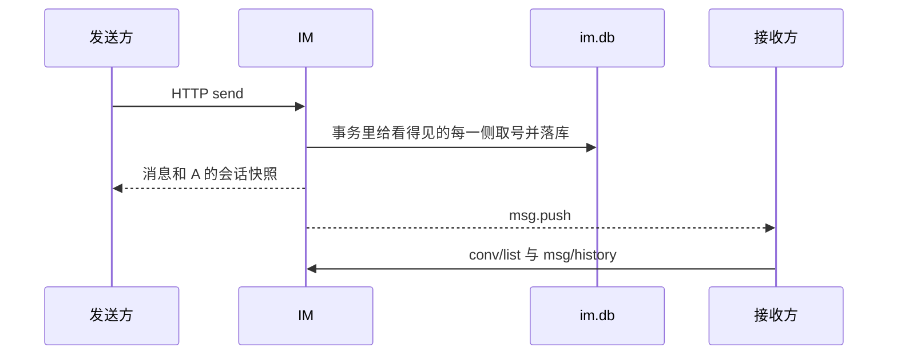

# 设计

字段含义和例子见 [字段](字段.md)。客户端怎样跟上这些序号见 [同步](同步.md)。

## 进程

IM 单独监听 `:8090`，HTTP 和 WebSocket 在同一端口。客户端直接访问 IM。

```text
IM 客户端
    |
    v
im 进程 :8090
    |-- user 模块     注册、登录、资料、封禁
    |-- kit           日志、JWT、错误、HTTP 包装
    |-- 内存连接表
    |-- im.db         仅本进程读写
```

```text
im    →  kit、user
im    不依赖 server
server 不依赖 im
```

两边不共享数据库和 JWT 密钥。`go.work` 在实现时加上 `./im`。`modules/file` 一期不接入。

```text
im/
  cmd/main.go
  api/im/im.proto
  configs/config.yaml
  internal/app/
  internal/hub/            user_id -> 连接
  internal/ws/
  pkg/model/
  pkg/dao/
  pkg/biz/
  pkg/controller/
  pkg/bizerror/            1100 段错误码
```

启动时打开自己的库，再交给用户模块：

```text
database.InitDb(im.db)
userdao.SetDB(database.GetDb())
```

聊天 Dao 使用同一个 `*gorm.DB`。

```yaml
env: test
server:
  http_addr: ":8090"
database:
  filename: im.db
logger:
  filename: ""
auth:
  jwt_secret: ""
  jwt_expire_hours: 168
im:
  system_token: ""             # 内部代发接口
  heartbeat_sec: 25
  idle_sec: 70
  max_conns_per_user: 5
  text_max_runes: 2000
```

封禁用 user 模块的 `ban_until`。连接升级和发送都走 kit 的账号可用性检查。

## 成员行就是会话

不建 `im_conversation`。两个用户一场私聊，`conv_id` 由两个用户 id 决定：数值上较小的在前，下划线，较大的在后，例如 `1_2`。比较的是整数，不是字符串。客户端在请求发出前用同一公式算出这个字符串。请求里仍然传 `peer_user_id`，服务端自己算 `conv_id`，不采纳客户端另外传入的会话 id。

这个 id 写在消息上，也写在双方的成员行上。

每个用户最多一行成员记录。行上带着这一侧自己的 `last_seq`、`last_msg_id`、`last_sender_id`、`last_preview`、`sort_ut`。因为有的消息只有一边能看见，两边这些值可以不同。

没有可见消息就不建成员行。用户打开聊天页、还没发送成功时，会话只存在于本地，服务端列表里不会出现。第一条他看得到的消息在同一个事务里建行并写入。

系统代发时，只给看得到的那一侧建行或改行。

列表同步按自己的 `last_seq` 升序捞增量。展示时按自己的 `sort_ut` 倒序。`sort_ut` 是当前最新消息的更新时间，不是同步游标。

## 消息

一条消息一行，落在 `im_message`。用户发送和系统代发共用这张表。

每个用户有一行计数 `im_user_seq`。他所有会话的同步序号都从这里取，下一个号总是比这个用户已经发出的号更大。同一条消息如果双方都看得见，A 取 A 的下一个号，B 取 B 的下一个号，两个数不必相等。看不见的一侧不取号，消息上该侧序号写 0。

用户发送：`origin = user`，双方都可见，两侧会话预览都更新。事务里给双方各取一个新序号，写到消息上，并把各自成员行的 `last_seq` 设成刚取到的号。

系统代发：`origin = system`，名义发送者是 A，对端是 B。可见性三选一，只给看得到的人取号、建行或改行。预览开关决定这次写不写这一侧的最新消息。规则和例子在 [字段](字段.md)。

正文更新：看得到的每一侧再各取一个新序号，写回消息上原来的那一列。旧序号留空，不再指向任何消息。`msg_id` 和 `ct` 不变。最新消息指针只在「被更新的就是这一侧当前最新的那条，并且这次要求刷新预览」时才改摘要和 `sort_ut`。

正文目前只有文本。`content_type` 列保留，一期请求里只接受文本。

提交成功后再推送。推送只发给看得到这条的用户，他的每条在线连接都推，包括发送者自己的其他设备。推送失败不影响落库，对方按自己的游标补。

同一幂等键、同一正文再次请求时返回已有行，不取新序号。同一幂等键换了正文，拒绝，不另插一行。

## 长连接

浏览器使用 WebSocket，路径 `/im/ws`。

鉴权发生在升级之前，规则用 kit：

| 环境 | 凭据 |
|------|------|
| 非 test | 查询参数 `access_token`，或 `Authorization` Header。浏览器用查询参数 |
| test | 查询参数 `user_id`。HTTP 仍用 Header `UserId` |

升级失败按 HTTP 401/403 返回，不进入帧协议。日志不记录 token 和完整查询串。

升级成功后不再发单独的就绪帧。心跳间隔见上面的配置，当前是：

- 客户端每 25 秒发 `ping`，服务端回 `pong`
- 70 秒没有入站帧则关闭连接
- 第 6 条连接建立时，关掉该用户最早的一条
- 单帧上限 64KB

```text
user_id -> conn_id -> 连接
```

`conn_id` 只在本进程有效。断线就从 map 删掉。服务端不记「哪些还没推」。重连之后客户端拉 [同步](同步.md) 里的两个接口。

用户发送只走 HTTP。长连接上没有发送命令。系统代发也只有内部 HTTP。

帧只有三类：`ping` / `pong`，以及服务端主动的 `msg.push`。`msg.push` 的数据是完整消息，序号是这条连接上的用户自己的。客户端可以立刻按 `msg_id` 画出来，然后马上拉会话列表和这场历史。推送本身不推进本地游标。



系统代发时，看不见的那一侧没有推送。

多条连接之间不保证谁先收到。先到的消息可以先显示，漏掉的由历史接口按序号补。

## 二期多机时怎么接

一期不实现。

1. 推送收口在 `Push(userID, frame)`。一期背后是本机 map。
2. 用户落到哪台机器，用 `modules/kit` 的一致性哈希对 `user_id` 取值。该用户的连接只建在那一台。
3. 同步序号仍从该用户的计数行上取，取号和写消息在同一个事务里。多写者要换成 MySQL 一类的库。

节点之间用 Redis 频道 `im:user:{user_id}` 即可。

客户端这一版只用一个前缀游标。本地如果以后必须记下「中间缺了一段」，再改成按区间补，现在不做。
