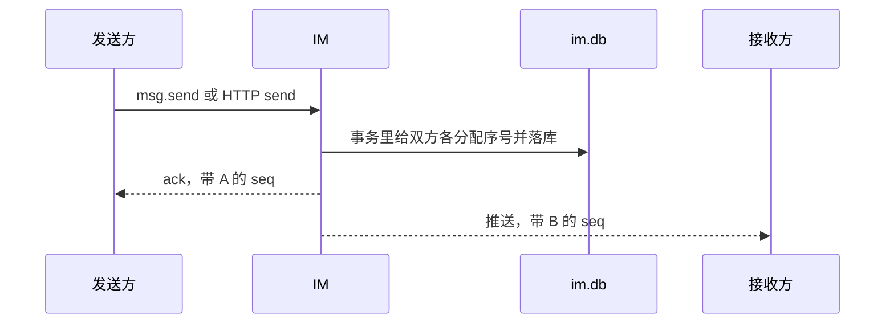

# 设计

字段含义和例子见 [字段](字段.md)。客户端怎样跟上这些序号见 [同步](同步.md)。

## 进程

IM 单独监听 `:8090`，HTTP 和 WebSocket 在同一端口。客户端直接访问 IM。

```text
IM 客户端
    |
    v
im 进程 :8090
    |-- user 模块     注册、登录、资料、封禁
    |-- kit           日志、JWT、错误、HTTP 包装
    |-- 内存连接表
    |-- im.db         仅本进程读写
```

```text
im    →  kit、user
im    不依赖 server
server 不依赖 im
```

两边不共享数据库和 JWT 密钥。`go.work` 在实现时加上 `./im`。`modules/file` 一期不接入。

```text
im/
  cmd/main.go
  api/im/im.proto
  configs/config.yaml
  internal/app/
  internal/hub/            user_id -> 连接
  internal/ws/
  pkg/model/
  pkg/dao/
  pkg/biz/
  pkg/controller/
  pkg/bizerror/            1100 段错误码
```

启动时打开自己的库，再交给用户模块：

```text
database.InitDb(im.db)
userdao.SetDB(database.GetDb())
```

聊天 Dao 使用同一个 `*gorm.DB`。

```yaml
env: test
server:
  http_addr: ":8090"
database:
  filename: im.db
logger:
  filename: ""
auth:
  jwt_secret: ""
  jwt_expire_hours: 168
im:
  system_token: ""             # 内部代发接口
  heartbeat_sec: 25
  idle_sec: 70
  max_conns_per_user: 5
  text_max_runes: 2000
```

封禁用 user 模块的 `ban_until`。连接升级和发送都走 kit 的账号可用性检查。

## 成员行就是会话

不建 `im_conversation`。两个用户一场私聊，用较小的用户 id `user_low` 和较大的 `user_high` 标识。这个一对 id 写在消息上，也写在双方的成员行上。

每个用户最多一行成员记录，行上带着原来会话表的那些字段：`last_seq`、`last_msg_id`、`last_sender_id`、`last_preview`、`last_msg_at`。这些值是**这个用户的视图**。因为有的消息只有一边能看见，两边的 `last_seq` 和 `last_msg_id` 可以不同，不是互相拷贝同一份快照。

`open` 保证双方成员行都存在。刚建好时 `last_seq = 0`，最后一条为空。

系统代发时，只给看得到的那一侧建行或改行。完全没参与过、又看不见这条的用户，不建成员行。

列表按自己的 `last_msg_at` 倒序。`last_seq = 0` 的行也返回，表示打开过但自己还没看见任何消息。

## 消息

一条消息一行，落在 `im_message`。用户发送和系统代发共用这张表。

用户发送：`origin = user`，双方都可见。事务里给双方各自的 `last_seq` 加一，消息上记下两个序号（看不见的一侧记 0，用户发送时两侧都大于 0）。

系统代发：`origin = system`，名义发送者是 A，对端是 B。可见性三选一，只给看得到的成员加序号、改最后一条。规则和例子在 [字段](字段.md)。

正文目前只有文本。`content_type` 列保留，一期请求里只接受文本。

提交成功后再推送。推送只发给看得到这条的用户。推送失败不影响落库，对方按自己的序号补。

同一幂等键再次请求时返回已有行，不加序号。

## 长连接

浏览器使用 WebSocket，路径 `/im/ws`。

鉴权发生在升级之前，规则用 kit：

| 环境 | 凭据 |
|------|------|
| 非 test | 查询参数 `access_token`，或 `Authorization` Header。浏览器用查询参数 |
| test | 查询参数 `user_id`。HTTP 仍用 Header `UserId` |

升级失败按 HTTP 401/403 返回，不进入帧协议。日志不记录 token 和完整查询串。

升级成功后服务端推 `conn.ready`。之后：

- 客户端每 25 秒发 `ping`，服务端回 `pong`
- 70 秒没有入站帧则关闭连接
- 第 6 条连接建立时，关掉该用户最早的一条
- 单帧上限 64KB

```text
user_id -> conn_id -> 连接
```

`conn_id` 只在本进程有效。断线就从 map 删掉。重连之后的补齐方式见 [同步](同步.md)，不依赖服务端记得「哪些还没推」。

用户发送可以走 WS `msg.send`，也可以走 HTTP，都进同一个 biz。系统代发只有内部 HTTP，不进用户的长连接命令。



系统代发时，看不见的那一侧没有 ack，也没有推送。

同一条连接上，服务端按该用户的序号顺序推。这只是减少乱序，客户端仍然按 [同步](同步.md) 处理后到的较大序号。多条连接之间不保证谁先收到。

## 二期多机时怎么接

一期不实现。

1. 推送收口在 `Push(userID, frame)`。一期背后是本机 map。
2. 用户落到哪台机器，用 `modules/kit` 的一致性哈希对 `user_id` 取值。该用户的连接只建在那一台。
3. 序号仍在锁住该成员行的事务里增加。多写者要换成 MySQL 一类的库。

节点之间用 Redis 频道 `im:user:{user_id}` 即可。
